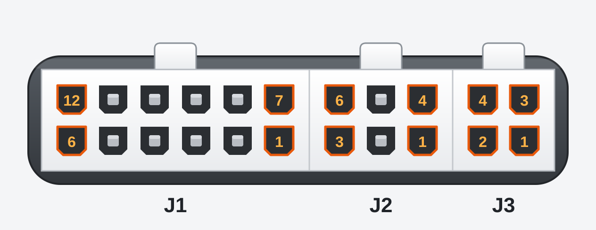

SANS Gateway
============

Funktionen
----------
* Anpassen von CAN Messages in einem bestehenden System. Typische Use-Cases hierfür sind
  - Anpassung der angezeigten Tachogeschwindigkeit mit einem einstellbaren Faktor
  - Ansteuerung von zusätzlichen Anbauteilen wie Scheinwerfern oder Lichtbalken je nach Zustand auf dem CAN Bus
* Übertragen von CAN Messages über andere Schnittstellen wie WiFi oder USB
* Die Einrichtung des Gateway erfolgt über WiFi im Webbrowser 
* Intern erweiterbar über 2,54mm Pinleisten, mit genug Platz für eine zweite Platine im Gehäuse.

Ausstattung
-----------
* ESP32-C6 Mini H4 mit 4MB Flash und erweiterem Temperaturbereich bis 105°C
* Zwei CAN Busse mit je max. 1MBit/s
* 9x Digital OUT, geschaltet gegen Masse bis 500mA, auf 2,54mm Pin Header und Molex Stecker (ein Pin geteilt mit Digital In über Lötjumper)
* 4x Digital IN, bis +32V, auf 2,54mm Pin Header und Molex Stecker
* Interner I2C Bus für Displays, Erweiterungen etc auf Pin-Header und JST-XH Stecker
* Nano-ESP32 kompatibler IO Header (2,54mm Raster)
* USB zur Programmierung, zum Debugging und zur Kommunikation mit einem anderen System, z.B. im Testerbetrieb.
  - USB steht entweder über eine Mini-USB Buchse zur Verfügung (Bestückungsoption) oder als Kontakte für ein TC-2050 USB Kabel.
  - Es handelt sich um ein ACM (Advanced Communication Module) Device das hohe Geschwindigkeiten ermöglicht (max. 5MBit laut Datenblatt), siche software-seitig aber wie RS-232 verhält. 
* Spannungsversorgung 8-32V

SANS Tester
-----------
Der SANS Tester ist eine Variante vom SANS Gateway mit zusätzlicher Ausstattung
* Mini-USB Buchse bestückt
* DIP Schalter zur Konfiguration der CAN Terminierung
* 128x32 Pixel OLED Display für Statusanzeigen etc. 

Software
--------
* ESP32RET: Leistungsfähiges Open Source Project für CAN Tester [Download](https://github.com/sans-ltd/ESP32RET/tree/sans_tester) 

Hardware-Dokumentation
----------------------

### Lötjumperbelegung

| Jumper | Funktion |
| ------ | -------- | 
| JP1    | Terminierung von CAN 0, nur beim Gateway |
| JP2    | Terminierung von CAN 1, nur beim Gateway |
| JP3    | Aktiviert Pull Up Widerstand gegen 5V für OUT3, z.B. für RS232 Kommunikation. |
| JP4    | Aktiviert Pull Up Widerstand gegen 5V für OUT2, z.B. für RS232 Kommunikation. |
| JP5    | J1 Pin 3 ist ein Output (OUT4). |
| JP6    | J1 Pin 3 ist ein Input. (IN4). |
| JP7    | Aktiviert Pull Up Widerstand gegen 5V für OUT8, z.B. für RS232 Kommunikation. |
| JP8    | Zum Brücken der Entstördrossel FL1, wenn diese nicht bestückt ist. |
| JP9    | Zusammen mit JP8 setzen. |
| JP10   | Verbindet IN2 mit GPIO14. Damit steht ein weiterer Input zur Verfügung, jedoch ist dann I2C nicht mehr möglich. |
| JP11   | Verbindet USB zum NanoESP Header. Nur bestücken, wenn USB dort tatsächlich genutzt wird, sonst können EMV Probleme auftreten. |
| JP12   | Zusammen mit JP12 setzen. |

### Steckerbelegung

#### Draufsicht am Gateway

#### Stecker J1 (12 Pol. Molex Mini Fit Jr.)
| Pin | Funktion |
| --- | -------- |
| 1   | Versorgungsspannung 8-32V |
| 2   | Masse |
| 3   | IN4 oder OUT4, in Abhängigkeit von JP5 und JP6 |
| 4   | OUT2 |
| 5   | CAN1 High |
| 6   | CAN1 Low |
| 7   | +5V Ausgang |
| 8   | IN3 |
| 9   | OUT3 |
| 10  | OUT1 |
| 11  | CAN0 High |
| 12  | CAN0 Low |

#### Stecker J2 (6 Pol. Molex Mini Fit Jr.)
| Pin | Funktion |
| --- | -------- |
| 1   | Versorgungsspannung 8-32V |
| 2   | Masse |
| 3   | OUT5 |
| 4   | OUT7 |
| 5   | OUT6 |
| 6   | IN7 |

#### Stecker J3 (4 Pol. Molex Mini Fit Jr.)
| Pin | Funktion |
| --- | -------- |
| 1   | OUT8 |
| 2   | IN8 |
| 3   | OUT9 |
| 4   | +5V Ausgang |

