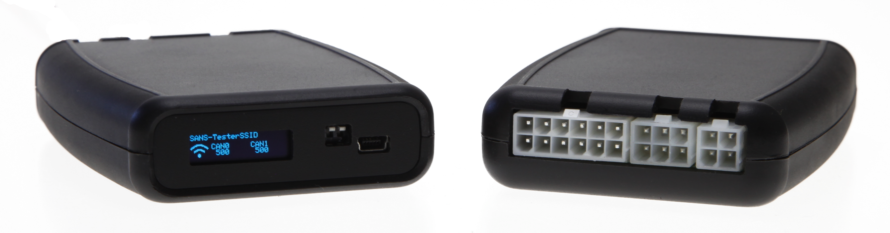
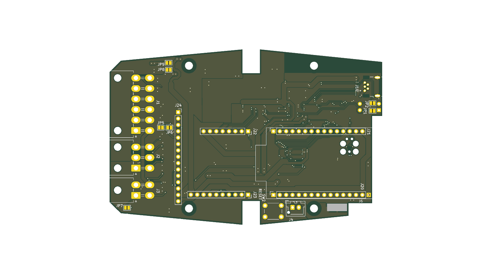

SANS Gateway
============

Übersicht
=========

Funktionen
----------
* Anpassen von CAN Messages in einem bestehenden System. Typische Use-Cases hierfür sind
  - Anpassung der angezeigten Tachogeschwindigkeit mit einem einstellbaren Faktor
  - Ansteuerung von zusätzlichen Anbauteilen wie Scheinwerfern oder Lichtbalken je nach Zustand auf dem CAN Bus
* Übertragen von CAN Messages über andere Schnittstellen wie WiFi oder USB
* Die Einrichtung des Gateway erfolgt über WiFi im Webbrowser 
* Hochwertiges und kompaktes Kunststoffgehäuse (118mm x 78mm x 23mm) mit Crimp-freundlichen Molex Mini-Fit Jr. Steckern
* Intern erweiterbar über 2,54mm Pinleisten, mit genug Platz für eine zweite Platine im Gehäuse: [Bild vom geöffneten Gerät](assets/gateway-open.jpg)

Ausstattung
-----------
* ESP32-C6 Mini H4 mit 4MB Flash und erweiterem Temperaturbereich bis 105°C
* Zwei CAN Busse mit je max. 1MBit/s
* 9x Digital OUT, geschaltet gegen Masse bis 500mA, auf 2,54mm Pin Header und Molex Stecker (ein Pin geteilt mit Digital In über Lötjumper)
* 4x Digital IN, bis +32V, auf 2,54mm Pin Header und Molex Stecker
* Interner I2C Bus für Displays, Erweiterungen etc auf Pin-Header und JST-XH Stecker
* Nano-ESP32 kompatibler IO Header (2,54mm Raster)
* USB zur Programmierung, zum Debugging und zur Kommunikation mit einem anderen System, z.B. im Testerbetrieb.
  - USB steht entweder über eine Mini-USB Buchse zur Verfügung (Bestückungsoption) oder als Kontakte für ein TC-2050 USB Kabel.
  - Es handelt sich um ein ACM (Advanced Communication Module) Device das hohe Geschwindigkeiten ermöglicht (max. 5MBit laut Datenblatt), siche software-seitig aber wie RS-232 verhält. 
* Spannungsversorgung 8-32V

SANS Tester
-----------
Der SANS Tester ist eine Variante vom SANS Gateway mit zusätzlicher Ausstattung
* Mini-USB Buchse bestückt
* DIP Schalter zur Konfiguration der CAN Terminierung
* 128x32 Pixel OLED Display für Statusanzeigen etc. 

Software
--------
* ESP32RET: Leistungsfähiges Open Source Project für CAN Tester [Download](https://github.com/sans-ltd/ESP32RET/tree/sans_tester) 

Hardware-Dokumentation
======================

Hardware-Features
-----------------
* Gehärtete Stromversorgung
  - Versorgungsspannungsbereich 8V bis 32V (VBAT)
  - Pads für Filterspule bei besonderen Anforderungen
  - Sicherung, Verpolungsschutz und Überspannungsschutz
  - Hocheffiziente DCDC-Wandler für 5V und 3,3V
* 2x Automotive Grade CAN Transceiver 
  - SN65HDV230
  - Standby und Wakeup-Fähig
  - mit zusätzlichem ESD Schutz
* 9x GPIO OUT (OUT1-OUT9) 
  - ULN2804, belastbar bis 500mA pro PIN, spannungsfest bis 32V
  - schalten invertiert als Open Collector gegen GND (HIGH -> OUTx wird GND, LOW -> floating)
  - Freilaufdiode gegen Versorgungsspannung
  - ACHTUNG: OUT9 ist wegen eines Pull-Up Widerstands zur Boot Konfiguration während des Boot-Vorgangs aktiv
* 4x GPIO IN (IN3, IN4, IN6, IN7)
  - ULN2804 als Spannungsschutz bis 32V  
  - schalten invertiert als Open Collector gegen GND
  - daher müssen die Pull-Up Widerstände im ESP an den entsprechenden GPIOs aktiv sein
  - INx >= 3,3V -> GPIO wird LOW
  - INx offen oder GND -> GPIO wird HIGH
* 2x ULN2804 Schaltstufen für Erweiterungen
  - Stehen auf den Erweiterungsheadern zur Verfügung, jedoch nicht am ESP32.
  - IN1 (ULN Eingang) auf GPIO11 (ULN Ausgang)
  - IN2 (ULN Eingang) auf GPIO10 (ULN Ausgang)
  - Da wir einen ESP32-C6 Mini verwenden, sind GPIO10 und GPIO11 nicht an der MCU verwendbar.
* Log-Ausgaben über USB
  - Da GPIO16 und GPIO17 für CAN1 gebraucht werden, gibt es keine serielle UART Konsole. 
  - Durch Setzen des Fuse-Bits `UART_PRINT_CONTROL` auf `1` werden auch die selten benötigten Bootloader-Ausgaben deaktiviert. 

Lötjumperbelegung
-----------------

| Jumper | Funktion |
| ------ | -------- | 
| JP1    | Terminierung von CAN 0, nur beim Gateway |
| JP2    | Terminierung von CAN 1, nur beim Gateway |
| JP3    | Aktiviert Pull Up Widerstand gegen 5V für OUT3, z.B. für RS232 Kommunikation. |
| JP4    | Aktiviert Pull Up Widerstand gegen 5V für OUT2, z.B. für RS232 Kommunikation. |
| JP5    | J1 Pin 3 ist ein Output (OUT4). |
| JP6    | J1 Pin 3 ist ein Input. (IN4). |
| JP7    | Aktiviert Pull Up Widerstand gegen 5V für OUT8, z.B. für RS232 Kommunikation. |
| JP8    | Zum Brücken der Entstördrossel FL1, wenn diese nicht bestückt ist. |
| JP9    | Zusammen mit JP8 setzen. |
| JP10   | Verbindet IN2 mit GPIO14. Damit steht ein weiterer Input zur Verfügung, jedoch ist dann I2C nicht mehr möglich. |
| JP11   | Verbindet USB zum NanoESP Header. Nur bestücken, wenn USB dort tatsächlich genutzt wird, sonst können EMV Probleme auftreten. |
| JP12   | Zusammen mit JP12 setzen. |
| R22    | Zum Unterbrechen von Tx an CAN 0 |
| R23    | Zum Unterbrechen von Rx an CAN 0 |
| R24    | Zum Unterbrechen von Tx an CAN 1 |
| R28    | Zum Unterbrechen von Rx an CAN 1 |
| R291   | Zum Unterbrechen der Standby-Steuerung beider CAN Transceiver |
| R292   | Bestücken, um die CAN Transceiver dauerhaft im Standby zu halten |

Steckerbelegung
---------------

### Draufsicht am Gateway

### Stecker J1 (12 Pol. Molex Mini Fit Jr.)
| Pin | Funktion |
| --- | -------- |
| 1   | Versorgungsspannung VBAT 8-32V |
| 2   | Masse |
| 3   | IN4 oder OUT4, in Abhängigkeit von JP5 und JP6 |
| 4   | OUT2 |
| 5   | CAN1 High |
| 6   | CAN1 Low |
| 7   | +5V Ausgang |
| 8   | IN3 |
| 9   | OUT3 |
| 10  | OUT1 |
| 11  | CAN0 High |
| 12  | CAN0 Low |

### Stecker J2 (6 Pol. Molex Mini Fit Jr.)
| Pin | Funktion |
| --- | -------- |
| 1   | Versorgungsspannung VBAT 8-32V |
| 2   | Masse |
| 3   | OUT5 |
| 4   | OUT7 |
| 5   | OUT6 |
| 6   | IN7 |

### Stecker J3 (4 Pol. Molex Mini Fit Jr.)
| Pin | Funktion |
| --- | -------- |
| 1   | OUT8 |
| 2   | IN8 |
| 3   | OUT9 |
| 4   | +5V Ausgang |

Belegung der internen Pin-Header
--------------------------------

### Positionen auf der Platine

### J20 und J21 nanoESP32-C6 Anschluss
| Pin    | Funktion an der MCU | Funktion im SANS Gateway |
| ------ | ------------------- | ------------------------ | 
| J20  1 |                     | GND                      | 
| J20  2 |                     | 3,3V Ausgang             |
| J20  3 | RESET               |                          |
| J20  4 | GPIO4               | IN8                      | 
| J20  5 | GPIO5               | IN7                      | 
| J20  6 | GPIO6               | Standby Steuerung der CAN Transceiver, HIGH = Standby, Low = Aktiv |
| J20  7 | GPIO7               | OUT1                     | 
| J20  8 | GPIO0               | IN4                      | 
| J20  9 | GPIO1               | IN3                      | 
| J20 10 | GPIO8               | I2C Clock                |
| J20 11 |                     | ULN2804 Ausgang von IN2 ( = GPIO10 am nanoESP) | 
| J20 12 |                     | ULN2804 Ausgang von IN1 ( = GPIO11 am nanoESP) |  
| J20 13 | GPIO12              | USB D- | 
| J20 14 | GPIO13              | USB D+ |  
| J20 15 |                     | 5V Ausgang|
|        |                     | | 
| J21  1 |                     | GND                      | 
| J21  2 | GPIO2               | CAN0 Tx                  |
| J21  3 | GPIO3               | CAN0 Rx                  |
| J21  4 | GPIO16              | CAN1 Tx                  | 
| J21  5 | GPIO17              | CAN1 Rx                  | 
| J21  6 | GPIO15              | OUT8 |
| J21  7 | GPIO23              | OUT7 |
| J21  8 | GPIO22              | OUT6 |
| J21  9 | GPIO21              | OUT5 |
| J21 10 | GPIO20              | OUT4 |
| J21 11 | GPIO19              | OUT3 |
| J21 12 | GPIO18              | OUT2 |
| J21 13 | GPIO9               | OUT9, ACHTUNG: während des Boot-Vorgangs aktiv |
| J21 14 |                     | GND Ausgang | 
| J21 15 |                     | 5V Ausgang |  

### J22 I2C und CAN Busse
| Pin    | Funktion an der MCU | Funktion im SANS Gateway |
| ------ | ------------------- | ------------------------ | 
|      1 | GPIO14              | I2C Data                 |
|      2 | GPIO8               | I2C Clock                |
|      3 |                     | CAN0 Low                 |
|      4 |                     | CAN0 High                |
|      5 |                     | CAN1 Low                 |
|      6 |                     | CAN1 High                |
|      7 |                     | GND                      |
|      8 |                     | 3,3V Ausgang             |

### J23 Inputs über ULN2804
| Pin    | Funktion an der MCU | Funktion im SANS Gateway |
| ------ | ------------------- | ------------------------ | 
|      1 |                     | IN1 -> J20 12            |
|      2 |                     | IN2 -> J20 11            |
|      4 | GPIO0               | IN4                      |
|      3 | GPIO1               | IN3                      |
|      5 | GPIO5               | IN7                      |
|      6 | GPIO4               | IN8                      |
|      7 |                     | GND                      |
|      8 |                     | 5V Ausgang               |
|      9 |                     | 3,3V Ausgang             |
|     10 |                     | VBAT Ausgang nach Verpolungsschutz |

### J24 Outputs über ULN2804
| Pin    | Funktion an der MCU | Funktion im SANS Gateway |
| ------ | ------------------- | ------------------------ | 
|      1 |                     | GND                      |
|      2 | GPIO7               | OUT1                     |
|      3 | GPIO18              | OUT2                     |
|      4 | GPIO19              | OUT3                     |
|      5 | GPIO20              | OUT4                     |
|      6 | GPIO21              | OUT5                     |
|      7 | GPIO22              | OUT6                     |
|      8 | GPIO23              | OUT7                     |
|      9 | GPIO15              | OUT8                     |
|     10 | GPIO9               | OUT9                     |
|     11 |                     | Masse Eingang            |
|     12 |                     | 5V Ausgang               |
|     13 |                     | VBAT Ausgang nach Sicherung, vor Verpolungsschutz, z.B. für Freilaufdioden |
|     14 |                     | VBAT Eingang             |
|     15 |                     | 3,3V Ausgang             |

### OLED Display
| Pin    | Funktion an der MCU | Funktion im SANS Gateway |
| ------ | ------------------- | ------------------------ | 
| J4   1 | GPIO14              | I2C Data                 |
| J4   2 | GPIO8               | I2C Clock                |
| J6     |                     | 3,3V Ausgang             |
| J7     |                     | GND                      |