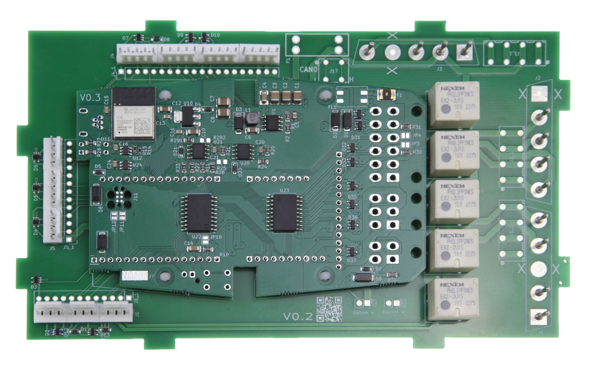

Sitzsteuerung für Range Rover, Rolls Royce und Bentley
======================================================

Funktionen
==========
* Retrofit für irreparabel beschädigte Controller-Platinen
  - Die Plantinen und der verbaute Microcontroller werden durch Batteriesäure der ausgelaufenen Pufferbatterie irreparabel beschädigt.
  - Unsere Baugruppe bildet die exakte Funktion nach, ohne auf eine Pufferbatterie angewiesen zu sein.
* Keine Anpassungen am Fahrzeug notwendig.
* Der kurze Kabelbaum im Steuergerät kann direkt eingesteckt werden. 
* Falls die Stecker am Kabelbaum stark korrodiert sind, können alternativ auch Wago Klemmen bestückt werden und die Kabel direkt aufgelegt werden.
* Steuerung der 4 Sitzmotoren und der beiden Außenspiegel
* Unterstützt beide Varianten der möglichen Spiegel-Joysticks ("rotes" und "schwarzes" Modell) für die Spiegel, inkl. automatischer Erkennung
* Memory Funktion im Flash des modernen Microcontrollers mit nahezu unbegrenzten Speicherplätzen
* Umfangreiche Diagnose-Möglichkeiten über WLAN Weboberfläche
* 2x GPIO Ausgänge und CAN Schnittstelle für Erweiterungen bei Retromods

Geplante zukünftige Funktionen
==============================
* Steuerung auch per App durch Bluetooth Low Energy
* Ansteuerung des Sonnendachs oder der Zentralverriegelung per App
* Kommunikation mit weiterer Peripherie über CAN bei Retromods

Hardware Beschreibung
=====================
* Basiert auf dem [SANS Gateway](SANS-Gateway.md)
* Moderne Relais-Matrix zum Steuern von bis zu zwei Motoren gleichzeitig
* Präzisions-AD Wandler zum Auswerten der Potentiometer in den Spiegeln für das Speichern der Position

Anmerkungen zum Einbau beim Range Rover
=======================================
* Die Erkennung des verwendeten Joysticks erfolgt beim Einschalten. Ein Wechsel des Joystick-Typs während des Betriebs kann zu Beschädigungen führen
* Verkabelung Richtung Fahrzeug:
  - Aufgrund der original etwas ungünstigen Masseführung muss der mit 4 6,3mm Flachkontakten bestückte Stecker als Erstes im Fahrzeugkabelbaum eingesteckt werden
  - Dies gewährleistet eine ausreichende Erdung und vermeidet Blindströme, die zur Beschädigung der Platine führen können.